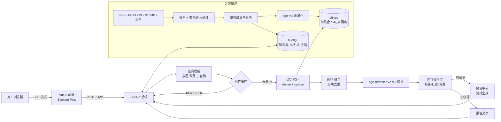

# MediKnow-RAG

> 院内知识库智能问答系统 · 一个**答案只来自院内原文、每条结论带出处**的 RAG 工程实现

[](https://www.python.org/)
[](https://fastapi.tiangolo.com/)
[](https://vuejs.org/)
[](https://milvus.io/)
[](LICENSE)

医院内部的诊疗规范、药品说明书、培训手册、管理制度散落在 PDF / PPT / Word / 流程图里。想确认一条用药原则，
往往要翻好几份文件；直接问通用大模型又看不到院内资料，还会一本正经地编造剂量和流程。

MediKnow-RAG 把这件事拆成可控的工程链路：**文档解析 → 父子分块 → 向量化入库 → 多路召回 → 精排 → 安全判定 → 流式作答 + 引用溯源**。
没有检索到依据时，系统**不会调用大模型**，而是直说「知识库未收录」。

> ⚠️ 仓库内的知识库文档全部是**脚本生成的合成演示数据**，不具备任何临床效力，不可用于实际诊疗。

<details>
<summary><b>English summary</b></summary>

MediKnow-RAG is a retrieval-augmented QA system for hospital internal knowledge bases, built with
FastAPI + Vue 3 + MySQL + Milvus. It parses PDF/PPTX/DOCX/Markdown/images, splits documents into
**section-level parent blocks** plus child chunks, indexes them into a shared Milvus collection isolated by
`kb_id`, and answers with **SSE streaming plus per-claim citations**. A safety layer refuses to answer when
no grounded context is retrieved, flags high-risk symptoms, and always renders a medical disclaimer.
Retrieval pipeline: multi-query rewriting (intent / simplification / sub-query / HyDE) → hybrid recall →
RRF fusion → bge-reranker-v2-m3 → top-k parent blocks.

</details>

---

## 目录

- [核心特性](#核心特性)
- [系统架构](#系统架构)
- [快速开始](#快速开始)
- [配置说明](#配置说明)
- [目录结构](#目录结构)
- [评测：RAGAS 四指标](#评测ragas-四指标)
- [性能与调优](#性能与调优)
- [已知限制与 Roadmap](#已知限制与-roadmap)
- [开发](#开发)
- [免责声明](#免责声明)

---

## 核心特性

**检索质量**

- **章节级父块分块**：按 Markdown `##` 切解析单元，父块 ≈ 一个章节（平均 290 字），子块 320 / 70 重叠。
  父块给模型看全文，子块进向量库——避免「标题被切到上一块、答案落在下一块」导致的误拒答。
- **多路查询改写**：一次 LLM 调用产出意图（专业/编程/通用/寒暄）、检索策略与改写变体
  （`direct` / `simplified` / `backtrack` / `subquery` / `hyde`）；短问题与寒暄走启发式不花调用。
- **混合召回 + RRF 融合 + 交叉编码器精排**：bge-m3 同时产出 1024 维稠密向量与稀疏词权重，
  多路结果 RRF 融合后按父块去重，再由 bge-reranker-v2-m3 精排取 top-3。
- **三级问答缓存**：归一化精确命中（Redis `HGET`）→ BM25 对称覆盖率 ≥0.8 近似命中 → 未命中才走完整 RAG。
  命中路径不写库、不失效索引，只累加计数并批量回写。

**可信与安全**

| 机制 | 行为 |
| --- | --- |
| 无依据拒答 | 未选知识库 / 库内无命中 / 相关度低于阈值 → **不调用大模型**，直接说明未收录 |
| 高危症状预警 | 识别胸痛、呼吸困难、意识障碍、大出血、儿童剂量等表述，在回答上方插入就医提示 |
| 强制免责声明 | 由后端配置下发、前端固定渲染，不依赖模型是否书写；正文不落库避免重复 |
| 引用可回溯 | 每条结论标注 `[N]`，展开可看文档名、页码、原文片段与相关度 |

**工程实现**

- 文档解析：PDF（表格还原为 Markdown、流程图裁剪存档、扫描页走 VL 模型转录）、PPTX、DOCX、
  Markdown/TXT、图片（OCR）；解析在 BackgroundTasks 中执行，前端轮询进度。
- 流式输出：SSE 事件序列 `meta → plan → cache → contexts → safety → vision → delta… → done`，
  检索路径（意图/变体/缓存命中）随消息落库，历史回看可见。
- 多模态问答：命中的父块带图时自动切视觉模型（最多 3 张），失败自动回退文本模型并下发 warning。
- 模型韧性：按 `LLM_AVAILABLE_MODELS` 顺序降级，403/404 拉黑 5 分钟；429 限流单独识别，
  按 `LLM_MAX_RPM` 本地排队 + 指数退避重试；`LLM_ENABLE_THINKING=false` 关闭 qwen3 的深度思考。
- 图片存储：本地静态目录或七牛云对象存储；私有空间只存规范 URL，出参时现签，链接过期可重新签。

---

## 系统架构



一次提问的完整链路：

1. **查询理解** — 判定意图与策略，必要时展开 2~4 路检索变体（带缓存，避免重复调用）。
2. **缓存判定** — 精确命中直接回放；BM25 覆盖率 ≥0.8 视为「换个问法问过」。
3. **召回** — 所有变体一次编码，在共享集合内按 `kb_id in [...]` 分别召回。
4. **融合与去重** — RRF 融合（`RAG_RRF_K`），回填父块，按父块去重只留最高分子块。
5. **精排** — bge-reranker-v2-m3 对「原始问题 × 父块全文」打分，取 `RAG_TOP_K`（默认 3）条。
6. **安全判定** — 空召回或分数过低则拒答；命中高危词附加提示。
7. **生成** — 按意图切换 system prompt，注入父块全文与页码，要求标注 `[N]`，SSE 增量返回。
8. **沉淀** — 问题 + 答案 + 参考资料写回问答缓存，下次同问题可直接命中。

---

## 快速开始

### 0. 前置依赖

| 依赖 | 版本 | 说明 |
| --- | --- | --- |
| Python | 3.11+（本项目在 3.13 验证） | 建议虚拟环境 |
| Node.js | 18+（本项目在 22 验证） | 前端构建 |
| MySQL | 8.0 | 表结构自动创建，无需手工建表 |
| Milvus | 2.4.x | 单机版即可 |
| Redis | 5.0+（可选） | 连不上自动降级为进程内缓存 |
| 模型权重 | bge-m3、bge-reranker-v2-m3 | **不进仓库**，下载后填本地路径 |

没有 MySQL / Milvus 时，用 `docker compose up -d` 一键拉起（见 `docker-compose.yml`）。

### 1. 模型权重

```bash
# 任选一种方式获取，目录结构如下
#   models/
#   ├── bge-m3/                     # 稠密 + 稀疏，约 2.2 GB
#   └── bge-reranker-v2-m3/
```

HuggingFace：`BAAI/bge-m3`、`BAAI/bge-reranker-v2-m3`；国内可用 ModelScope 镜像。

### 2. 配置

```bash
cp .env.example .env
# 至少填这四项：
#   MYSQL_PASSWORD=你的密码
#   EMBEDDING_MODEL_PATH=/绝对路径/models/bge-m3
#   RERANK_MODEL_PATH=/绝对路径/models/bge-reranker-v2-m3
#   LLM_API_KEY=你的通义千问 Key
```

### 3. 启动

```bash
# 后端
python -m venv .venv
.venv\Scripts\activate                 # Windows；Linux/macOS: source .venv/bin/activate
pip install -r backend/requirements.txt
cd backend && uvicorn app.main:app --host 127.0.0.1 --port 8001

# 前端（另开一个终端）
cd frontend
npm install
npm run dev
```

- 前端：http://127.0.0.1:5173 （注册后即可使用，验证码直接显示在页面上）
- 接口文档：http://127.0.0.1:8001/docs
- 模型自检：http://127.0.0.1:8001/api/v1/system/llm-status

Windows 下也可以直接双击 **`start_all.bat`**：自动检查依赖、分别拉起前后端、等端口就绪后打开浏览器；
`stop_all.bat` 一键停止。

### 4. 灌入演示数据（可选）

```bash
# 14 份多科室合成文档（已在 data/medical_docs，可直接入库）
python scripts/data/seed_medical_kb.py --username <你的账号> --kb "院内知识库（演示）"

# 需要重新生成文档时
python scripts/data/generate_medical_docs.py          # 校验
python scripts/data/generate_training_handbook.py     # 生成 7 页扫描版培训手册 PDF
```

---

## 配置说明

配置集中在根目录 `.env`（`extra="ignore"`，缺失项走代码默认值）。完整清单见 `.env.example`，关键项：

| 分组 | 关键项 | 说明 |
| --- | --- | --- |
| 检索 | `RAG_CHUNK_SIZE` / `RAG_CHUNK_OVERLAP` | 子块长度与重叠，默认 320 / 70 |
| 检索 | `RAG_TOP_K` | 注入提示词的父块条数，默认 3（实测 5→3 指标不变、上下文省 40%） |
| 检索 | `RAG_CANDIDATE_K` | 精排候选广度，与 `RAG_TOP_K` 解耦；它才是精排耗时的来源 |
| 检索 | `RAG_RRF_K` | 多路召回融合常数，默认 60 |
| 查询理解 | `QUERY_REWRITE_MIN_CHARS` | 低于该字数不走 LLM，直接用原问题检索 |
| 查询理解 | `QUERY_MAX_VARIANTS` | 单次最多展开几路 query |
| 大模型 | `LLM_AVAILABLE_MODELS` | **顺序即降级顺序**，前一个 403/404 自动换下一个 |
| 大模型 | `LLM_ENABLE_THINKING` | qwen3 系列默认开深度思考，`false` 显式关闭，首字延迟约降 2.5 s |
| 大模型 | `LLM_MAX_RPM` / `LLM_RATE_RETRIES` | 429 限流的本地排队速率与退避次数 |
| 缓存 | `QA_CACHE_THRESHOLD` | BM25 覆盖率阈值，达到即回放答案 |
| 缓存 | `QA_CACHE_MAX_PAIRS` | MySQL 只留这么多条高频问答，超出按命中数淘汰 |
| 安全 | `SAFETY_MIN_SCORE` | 低于该分拒答（bge-reranker 量纲，0 表示只拦空召回） |
| 安全 | `KB_SHARED_READ` | `true` 全院共用知识库（写操作仍限所有者）；`false` 按用户隔离 |

> **密钥安全**：`.env` 已在 `.gitignore` 中；`JWT_SECRET` 上线前请换成随机串：
> `python -c "import secrets;print(secrets.token_urlsafe(48))"`。

---

## 目录结构

```
MediKnow-RAG/
├── backend/
│   ├── requirements.txt
│   └── app/
│       ├── main.py               # FastAPI 入口（含 /api/v1/media 静态挂载）
│       ├── api/v1/               # auth / knowledge / documents / chat / system
│       ├── core/                 # 配置、日志、JWT、验证码、异常
│       ├── db/                   # 引擎、会话、建库建表
│       ├── models/               # SQLAlchemy 模型
│       ├── schemas/              # Pydantic 数据结构
│       └── services/             # 解析·分块·向量化·检索·精排·LLM·对话·缓存·安全
├── frontend/
│   ├── src/
│   │   ├── api/                  # axios 封装 + SSE 客户端
│   │   ├── components/           # 通用组件与聊天组件
│   │   ├── views/                # 登录/注册/对话/知识库/详情/解析预览
│   │   ├── stores/               # Pinia
│   │   └── styles/               # 主题与 Element Plus 定制
│   ├── vite.config.js
│   └── package.json
├── scripts/
│   ├── data/                     # 演示文档生成、知识库灌库
│   ├── eval/                     # RAGAS 四指标、纯检索评测、HTML 看板
│   ├── bench/                    # 大模型连通性、思考开关耗时、并发压测、端到端冒烟
│   └── ops/                      # 重建索引、schema 迁移、缓存运维
├── tests/                        # pytest（123 项：单元 + 集成）
├── data/
│   ├── medical_docs/             # 14 份多科室合成文档（Markdown）
│   ├── samples/                  # 解析回归样本（含扫描页 PDF）
│   └── eval/                     # 评测用例集（20 条 / 50 条）
├── docker-compose.yml            # MySQL + Milvus 备用编排
├── start_all.bat / stop_all.bat  # Windows 一键启停
├── .env.example
└── pyproject.toml                # 项目元信息 + pytest 配置
```

脚本速查见 [`scripts/README.md`](scripts/README.md)。

---

## 评测：RAGAS 四指标

不依赖 `ragas` 包（会引入 langchain / datasets 与现有依赖栈冲突），按其原始定义用「大模型判定 + 本地向量」实现，
判定与生成喂给模型的都是**父块全文**，与线上一致：

| 指标 | 计算方式 |
| --- | --- |
| Context Precision | 逐条判定召回资料对推导参考答案是否有用 → AP@K（相关项越靠前分越高） |
| Context Recall | 参考答案拆成原子陈述，逐条核对能否在召回资料中找到依据 |
| Faithfulness | 回答拆成原子陈述，逐条核对是否被资料支撑 |
| Answer Relevancy | 由答案反推 3 个问题，与原问题算 bge-m3 稠密余弦均值 |

```bash
# 20 条快评（约 12 分钟：检索生成 9 分钟 + 判定 2 分钟）
python scripts/eval/eval_ragas.py --stage all --cases data/eval/ragas_cases_20.json --tag quick

# 50 条全量
python scripts/eval/eval_ragas.py --stage all --cases data/eval/ragas_cases_50.json --tag full

# 只补算缺失指标（复用已有分数，省掉重复判定）
python scripts/eval/eval_ragas.py --stage judge --from data/eval/run_quick.jsonl \
    --resume data/eval/scores_quick.json --tag quick

# 生成 HTML 看板
python scripts/eval/ragas_report_html.py --scores data/eval/scores_quick.json
```

**当前基线**（20 条分层用例，覆盖 15/15 份文档，精排开启，`RAG_TOP_K=3`）：

| 指标 | 得分 |
| --- | --- |
| Context Precision | **1.0000** |
| Context Recall | **0.9875** |
| Faithfulness | **0.9938** |
| Answer Relevancy | **0.8154** |

20 条里 18 条三项指标满分，只有 `PED-01`（婴儿发热就医指征）漏了一条陈述。`Answer Relevancy`
长期稳定在 0.81~0.84，是**指标口径特性**而非质量问题：答案越具体、越长，反推出来的问题越抽象，
与原问题的稠密余弦天然上不去。

### 这套评测的已知局限（别把 1.0 当成「系统很强」）

1. **测试集偏易**：问题平均不到 20 字，几乎全是「单文档 + 单事实」直问，跨文档综合与因果推理为 0 条。
   它能验证「能不能找到」，验证不了「找全没有、会不会综合」。
2. **召回率由出题方式决定**：`ground_truth` 全部摘自库内单一文档，检索在 15 份文档里几乎必中金标文档。
3. **判定噪声约 ±5 个点**：同一份上下文重判可能 0.00 ↔ 1.00。
4. 想评估检索本身，应看**子块级指标**（金标文档命中位次、MRR、Recall@k），而不是这四个对粒度不敏感的指标。

---

## 性能与调优

| 环节 | 典型耗时（CPU） | 说明 |
| --- | --- | --- |
| 查询改写（LLM） | 1.5~3.5 s | 短问题走启发式，不花这次调用 |
| 检索（含精排） | 13~39 s | **真正的瓶颈**：bge-reranker 在 CPU 上约 1 s/对 |
| 生成首字 | 1.0~1.5 s | 关闭深度思考后；开启时约 3.5 s |

调优手段，按性价比排序：

1. **`RAG_CANDIDATE_K` 20 → 8**：精排候选减半，实测检索 12.45 s → 5.68 s，Hit@3 保持 1.00。
   代价是精排广度下降，跨文档的难问题需要重新回归。
2. **精排上 GPU**：`EMBEDDING_DEVICE=cuda`（同时作用于 bge-m3 与 reranker），单次检索可压到 1 s 内。
3. **`LLM_ENABLE_THINKING=false`**：qwen3.8-max 首字 3.54 s → 1.05 s，总耗时 −43%。
4. **`LLM_MAX_RPM`**：多人同时提问时按分钟排队，比撞 429 整批失败划算。

---

## 已知限制与 Roadmap

- [ ] 评测集补「跨文档 / 多跳 / 同义改写」难题，并加子块级 `Recall@k` 与 MRR。
- [ ] 精排候选自适应：按首轮 RRF 分数的落差动态决定候选数量。
- [ ] 流式生成中断后的续写（当前首个 token 之后不可重试，只能报错）。
- [ ] 单测覆盖 SSE 与多模态链路的异常分支。
- [x] 章节级父子分块（解决父块=整篇文档导致的指标饱和）
- [x] 429 限流本地排队 + 退避重试
- [x] qwen3 深度思考开关

---

## 开发

```bash
# 单元测试（不依赖 MySQL / Milvus / 大模型）
python -m pytest tests/test_chunking.py -v

# 全量（123 项，需要 MySQL + Milvus，测试库 subjects_kg_test 与集合前缀 test_kb_ 会自动清理）
python -m pytest -v

# 只跑集成测试
python -m pytest -m integration -v

# 大模型连通性与降级自检
python scripts/bench/check_llm.py
```

CI 只做两件在无外部依赖时也能稳定通过的事：**后端 `compileall` 语法检查** 与 **前端 `npm ci && npm run build`**。
集成测试依赖真实数据库与模型权重，请在本地或自建 Runner 上跑。

---

## 免责声明

- 本仓库所有医学内容均为脚本生成的**合成演示数据**，不构成任何医疗建议，不可用于诊疗决策。
- 系统未接入真实患者数据。若要上传真实病历或检查报告，必须先行脱敏（姓名、证件号、手机号、住院号），
  并补充访问审计与按科室的数据隔离策略。
- 生产部署请务必：`DEBUG=false`、更换 `JWT_SECRET`、为 MySQL/Redis 设置强密码与网络隔离。

## License

[MIT](LICENSE)
